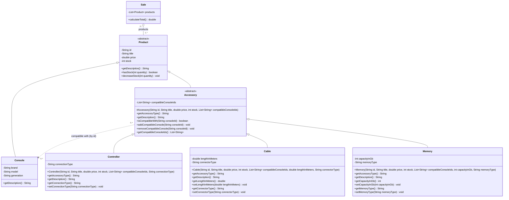
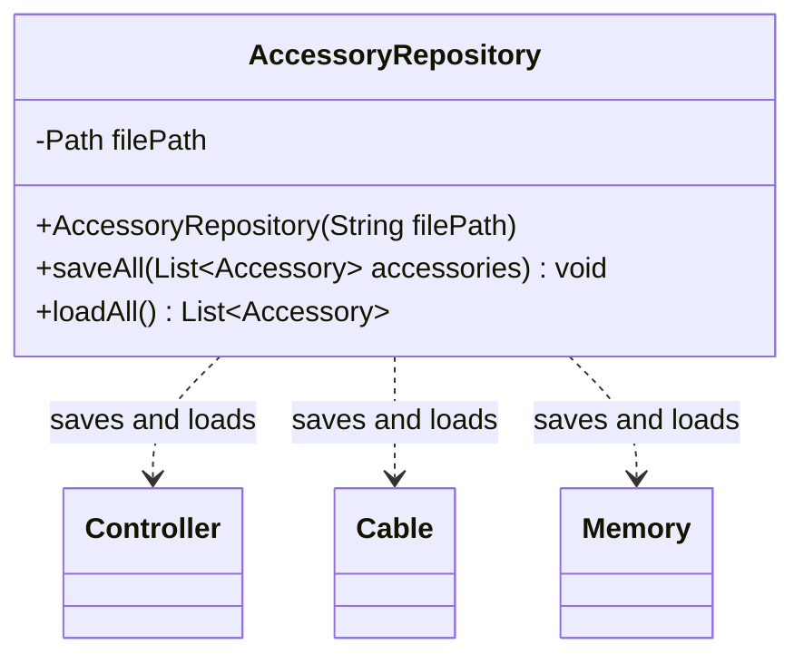
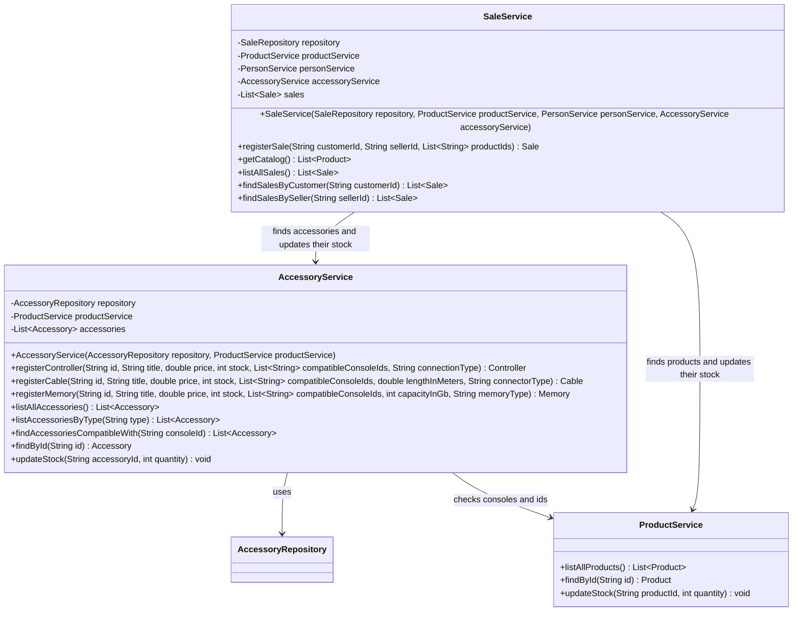
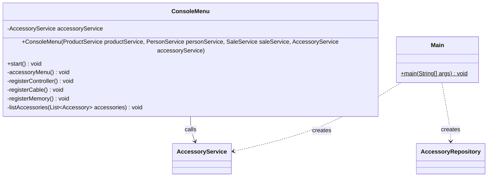

# Accessory Module Class Diagram — GameZone Unicesar

New classes of Requirement 1 and how they connect with the existing system. Classes that
already existed are shown only with the members relevant to this module.

- Visibility: `+` public, `-` private, `#` protected.
- `<<abstract>>` marks abstract classes; `*` after a method marks an abstract method.

---

## Model — `com.gamezone.model`

- `Accessory` extends `Product`, so it inherits `id`, `title`, `price`, `stock`, `hasStock`
  and `decreaseStock`.
- `getAccessoryType()` is abstract in `Accessory`. Each subclass returns `"CONTROLLER"`,
  `"CABLE"` or `"MEMORY"`.
- `Accessory.getDescription()` describes the common data and the compatible consoles. Each
  subclass overrides it, calls `super.getDescription()` and adds its own attributes.
- Compatibility is stored as console ids in `compatibleConsoleIds`.
- `Sale` does not change. Its `products` list can contain accessories because they are
  products.

---

## Persistence — `com.gamezone.persistence`

- File: `data/accessories.csv`, preloaded with one controller, one cable and one memory.
- Format: `type;id;title;price;stock;compatibleConsoles;extra1;extra2`, with a header line.
  The type (`CONTROLLER`, `CABLE`, `MEMORY`) tells which subclass to rebuild. The console
  ids go separated by commas.
- `loadAll` returns an empty list when the file does not exist. Like the other
  repositories, both methods declare `throws IOException`.

---

## Services — `com.gamezone.service`

**`AccessoryService`**
- Loads the accessories in its constructor and saves after every change. File errors
  become `IllegalStateException`, like in `ProductService`.
- It rejects invalid data with an `IllegalArgumentException` and a message in Spanish:
  - empty id or title, a price that is not greater than zero, or a negative stock;
  - an id already used by an accessory or a product;
  - a compatible id that is not a console of the inventory;
  - a type other than `CONTROLLER`, `CABLE` or `MEMORY`;
  - not enough stock.
- `findById` ignores letter case, like `ProductService`.

**`SaleService`**
- New dependency: `AccessoryService`.
- `getCatalog()` returns products and accessories together.
- `registerSale` resolves each id as a product or an accessory and updates the stock
  through the service that owns the item. Its signature does not change.

---

## User interface and entry point

- New main menu option **4. Gestión de accesorios**, with:
  1. Registrar control
  2. Registrar cable
  3. Registrar memoria
  4. Listar todos los accesorios
  5. Listar accesorios por tipo
  6. Consultar accesorios compatibles con una consola
- When registering a sale, the menu shows products and accessories (`getCatalog()`), so
  both can be added to the same sale.
- `Main` creates `AccessoryRepository` with `data/accessories.csv` and `AccessoryService`
  after `ProductService`, and passes it to `SaleService` and `ConsoleMenu`.

## Who implements what

| Member | Classes |
|---|---|
| Developer 1 (Andrés) | `Accessory`, `Controller`, `Cable`, `Memory` |
| Developer 2 (José) | `AccessoryRepository`, `AccessoryService`, `data/accessories.csv` |
| Technical Leader (Rafael) | Changes in `SaleService`, `ConsoleMenu`, `Main` and `README.md` |
