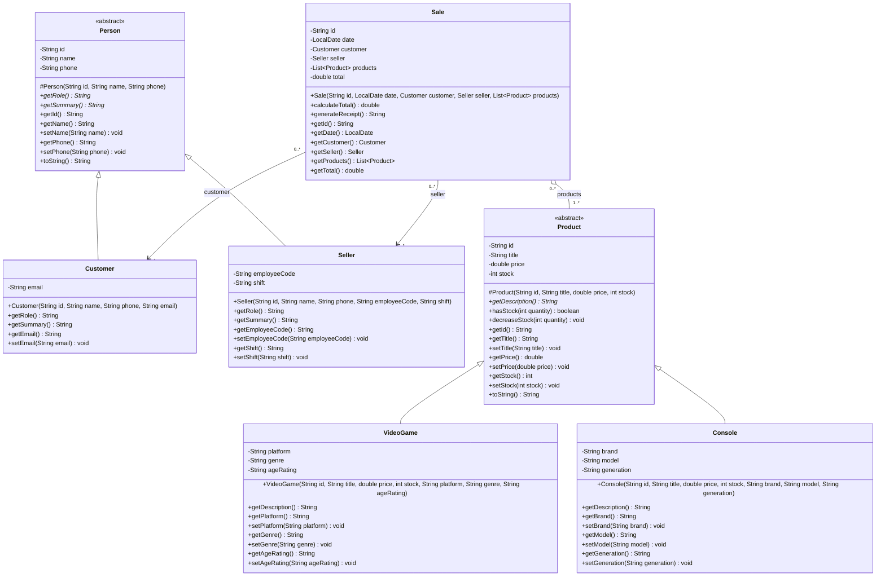
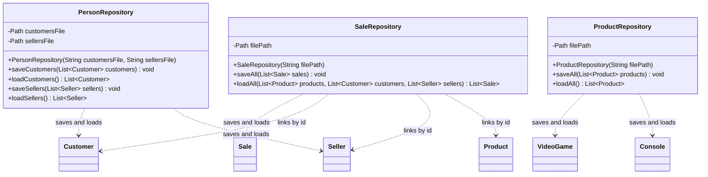
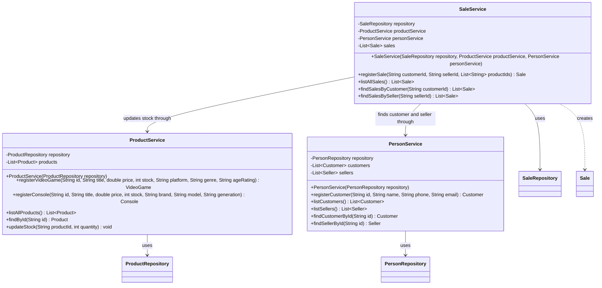
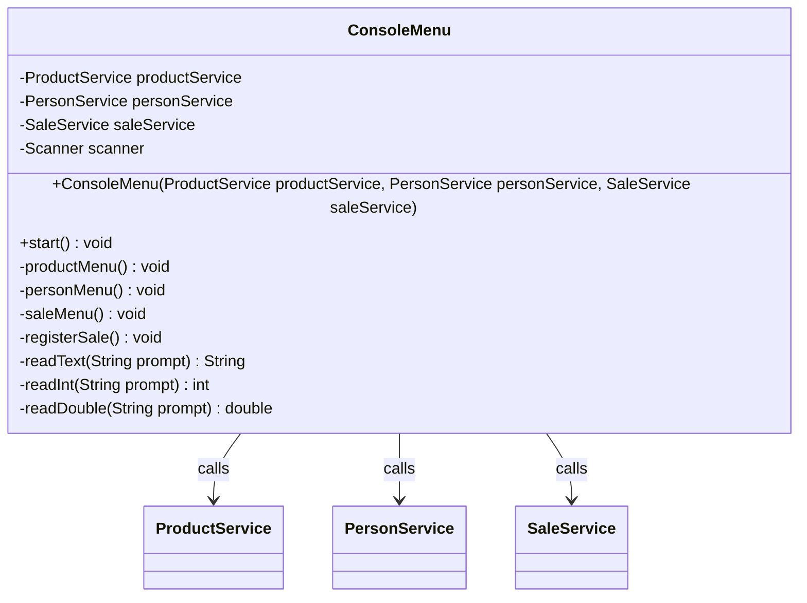
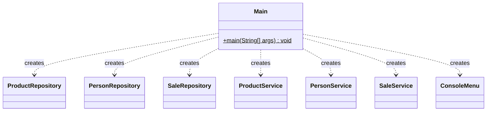

# Class Diagram — GameZone Unicesar

Classes of the four layers with their attributes, main methods and relationships.

- Visibility: `+` public, `-` private, `#` protected.
- `<<abstract>>` marks abstract classes; `*` after a method marks an abstract method.
- `$` marks a static method.

---

## Model — `com.gamezone.model`

- Every attribute of the model is `private`; access goes through getters and setters.
- `Person` and `Product` are abstract, and their constructors are `protected`.
- `getRole()`, `getSummary()` and `getDescription()` are abstract in the base class and
  implemented with `@Override` in each subclass.
- `Sale` keeps one entry per unit sold in `products` and computes its own `total`.

---

## Persistence — `com.gamezone.persistence`

- Data files: `data/customers.csv`, `data/sellers.csv` (three preloaded sellers),
  `data/products.csv` and `data/sales.csv`.
- Every load method returns an empty list when its file does not exist yet.
- `ProductRepository` writes the type (`VIDEOGAME` or `CONSOLE`) as the first column, so
  it knows which subclass to rebuild.
- A sale is stored with the ids of its customer, seller and products. `loadAll` receives
  the objects already loaded and links each sale to them.

---

## Services — `com.gamezone.service`

- Each service loads its data in the constructor and saves after every change.
- Invalid data or a broken rule throws an `IllegalArgumentException` with a message in
  Spanish, which the menu shows to the user.
- `findSellerById` accepts the seller's identification or employee code.

---

## User interface — `com.gamezone.ui`

- The menu only talks to the services; it never uses a repository.
- Messages shown to the user are in Spanish; code identifiers are in English.

---

## Application entry point — `com.gamezone`

`Main` creates the repositories, passes them to the services through their constructors,
passes the services to `ConsoleMenu` and starts the menu.
