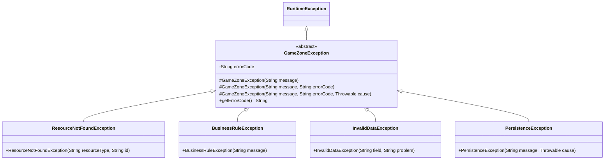
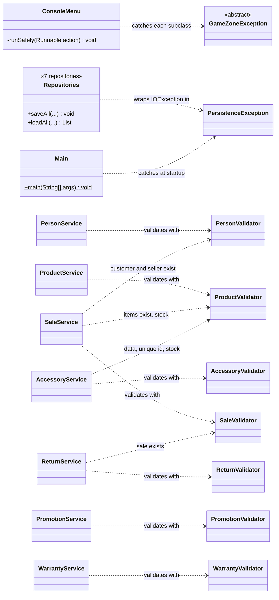

# Exception and Validation Class Diagram — GameZone Unicesar

New classes of Requirement 6 and how they connect with the existing system. Classes that
already existed are shown only with the members relevant to this change.

- Visibility: `+` public, `-` private, `#` protected.
- `<<abstract>>` marks abstract classes; `$` marks a static method.

---

## Exceptions — `com.gamezone.exceptions`



| Class | Error code | Message built by the constructor |
|---|---|---|
| `ResourceNotFoundException` | `RESOURCE_NOT_FOUND` | `"No existe " + resourceType + " con identificador " + id + "."` → for example, "No existe el producto con identificador VG-09." |
| `BusinessRuleException` | `BUSINESS_RULE` | The message received, for example, "Stock insuficiente para Elden Ring. Disponible: 2, solicitado: 3." |
| `InvalidDataException` | `INVALID_DATA` | `"El campo " + field + " " + problem + "."` → for example, "El campo precio debe ser mayor que cero." |
| `PersistenceException` | `PERSISTENCE_ERROR` | The message received, which names the file and the operation. The cause is kept with `super(message, code, cause)`. |

- `GameZoneException` is abstract and extends `RuntimeException`, so it is unchecked.
- Its first constructor uses the code `GAMEZONE_ERROR`.
- `resourceType` already includes its article (`"el producto"`, `"la venta"`), so the
  message is grammatically correct for every resource.

---

## Validators — `com.gamezone.validation`

Every validator is a `final` class with a private constructor and only static methods.
The validators depend only on `model` and `exceptions`.

```mermaid
classDiagram
    direction TB

    class ProductValidator {
        +validateProductData(String id, String title, double price, int stock)$ void
        +validateUniqueProduct(Product existing, String id)$ void
        +validateProductExists(Product product, String productId)$ void
        +validateStockAvailability(Product product, int requestedQuantity)$ void
        +validateQuantity(int quantity)$ void
    }
    class PersonValidator {
        +validatePersonData(String id, String name, String email, String phone)$ void
        +validatePersonExists(Person person, String personId)$ void
        +validateUniquePerson(List~? extends Person~ existing, String newId)$ void
    }
    class SaleValidator {
        +validateSaleData(Customer customer, Seller seller, List~Product~ products)$ void
        +validateSaleExists(Sale sale, String saleId)$ void
        +validateExtendedWarrantyRequest(List~Product~ products, List~String~ productIds)$ void
    }
    class AccessoryValidator {
        +validateAccessoryType(String type)$ void
        +validateCompatibleConsole(Product product, String consoleId)$ void
        +validateAccessoryExists(Accessory accessory, String accessoryId)$ void
    }
    class PromotionValidator {
        +validatePromotionData(String id, String name, LocalDate startDate, LocalDate endDate)$ void
        +validatePercentage(double percentage)$ void
        +validateCategory(String category)$ void
        +validateMinimumQuantity(int minimumQuantity)$ void
        +validateUniquePromotion(Promotion existing, String id)$ void
    }
    class WarrantyValidator {
        +validateWarrantyData(Product product, Sale sale, LocalDate startDate)$ void
        +validateDaysAhead(int daysAhead)$ void
    }
    class ReturnValidator {
        +validateReturnData(List~String~ productIds, String reason)$ void
        +validateReturnWindow(Sale sale)$ void
        +validateUnitsAvailable(Sale sale, String productId, int requested, int alreadyReturned)$ void
        +validateMonth(int month)$ void
    }
```



**Which exception each method throws:**

- `InvalidDataException`, when a value has a wrong format or range:
  - `validateProductData`, `validateQuantity`, `validatePersonData`;
  - `validateAccessoryType`, `validatePromotionData`, `validatePercentage`,
    `validateCategory`, `validateMinimumQuantity`;
  - `validateWarrantyData`, `validateDaysAhead`, `validateReturnData` (when the reason is
    empty), `validateMonth`.
- `ResourceNotFoundException`, when an object that was looked up is `null`:
  - `validateProductExists`, `validatePersonExists`, `validateSaleExists`,
    `validateAccessoryExists`;
  - `validateCompatibleConsole`, when the console does not exist.
- `BusinessRuleException`, when a rule of the store is broken:
  - `validateUniqueProduct`, `validateUniquePerson`, `validateUniquePromotion`;
  - `validateStockAvailability`;
  - `validateSaleData`, for an empty list of products;
  - `validateExtendedWarrantyRequest`;
  - `validateCompatibleConsole`, when the product is not a console;
  - `validateReturnData`, when there are no products;
  - `validateReturnWindow`, `validateUnitsAvailable`.

**Rules kept from the current code:**

- `validatePersonData`:
  - id, name and phone are required;
  - the phone has only digits;
  - the email has an `@` and a `.`.
- `validateCategory` accepts `VIDEOGAME`, `CONSOLE` and `ACCESSORY`.
- `validatePercentage` accepts values greater than 0 and up to 100.
- `validateUnitsAvailable` covers both cases:
  - an id that is not in the sale (the sale has 0 units of it);
  - asking for more units than the ones still left to return.

---

## How the services and repositories use the new layer



**Services** (Developer 2)
- Every `throw new IllegalArgumentException(...)` becomes a call to the matching validator.
- The wrappers `catch (IOException) → IllegalStateException` disappear, because the
  repositories now throw `PersistenceException` themselves.
- `PersonService` no longer declares `throws IOException`.
- The finder methods (`findById`, `findCustomerById`, `findSellerById`...) keep returning
  `null`. The operations that need the resource call `validate...Exists`.

**Repositories** (Developer 2)
- `ProductRepository`, `PersonRepository`, `AccessoryRepository`, `PromotionRepository`,
  `WarrantyRepository`, `SaleRepository` and `ReturnRepository` catch `IOException` and
  throw:

  ```java
  new PersistenceException("Error de lectura en el archivo " + filePath, e)
  ```

  or the same message with "escritura" when writing. Their methods no longer declare
  `throws IOException`.
- A line that references a missing customer, seller or product throws
  `PersistenceException("El archivo " + filePath + " tiene un formato inválido", e)`.
  Today `SaleRepository` throws `IllegalStateException` in that case.

**Model**
- The guards inside `Product.decreaseStock` and the `Return` constructor stay as
  `IllegalArgumentException`. They are internal checks of the objects themselves. The
  services always validate first, so a user can never reach them.

**`ConsoleMenu` and `Main`** (Technical Leader)
- Every submenu runs its operation inside `runSafely(...)`. It has one catch per
  subclass, with the four messages of the statement.
- The user never sees a stack trace or a technical message.
- `Main` catches `PersistenceException` while the services load their data and shows:
  "No fue posible cargar los datos del sistema. Contacte al administrador."

## Who implements what

| Member | Work |
|---|---|
| Developer 1 (Andrés) | `com.gamezone.exceptions`: `GameZoneException` and its 4 subclasses. `com.gamezone.validation`: the 7 validators. |
| Developer 2 (José) | The 7 services use the validators and throw typed exceptions; the 7 repositories throw `PersistenceException` with context. When removing `throws IOException` from `PersonService`, he also removes the `catch (IOException)` that `ConsoleMenu.personMenu` and `Main` have today, so the project keeps compiling. |
| Technical Leader (Rafael) | `ConsoleMenu.runSafely` with differentiated messages, the startup catch in `Main`, and `README.md` |
