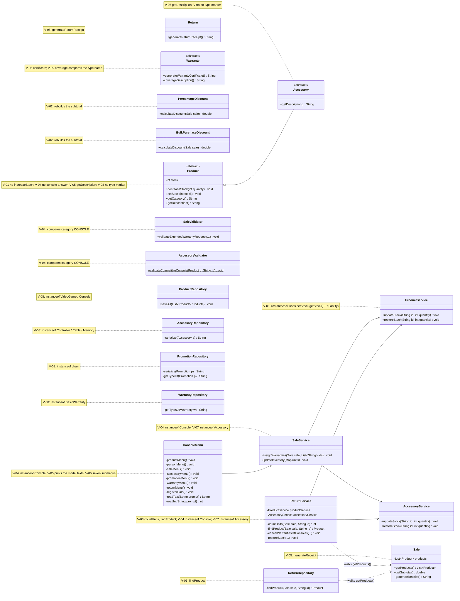

# GRASP Class Diagram — Before and After

Classes involved in the nine violations of `docs/grasp-audit/consolidated-audit.md`. Only the
members related to each violation are shown. Notes give the violation identifiers of each
class.

## Before (start of Phase 2, `develop` at `ae12127`)

## After (end of Phase 2)

To be drawn when every correction is merged.
