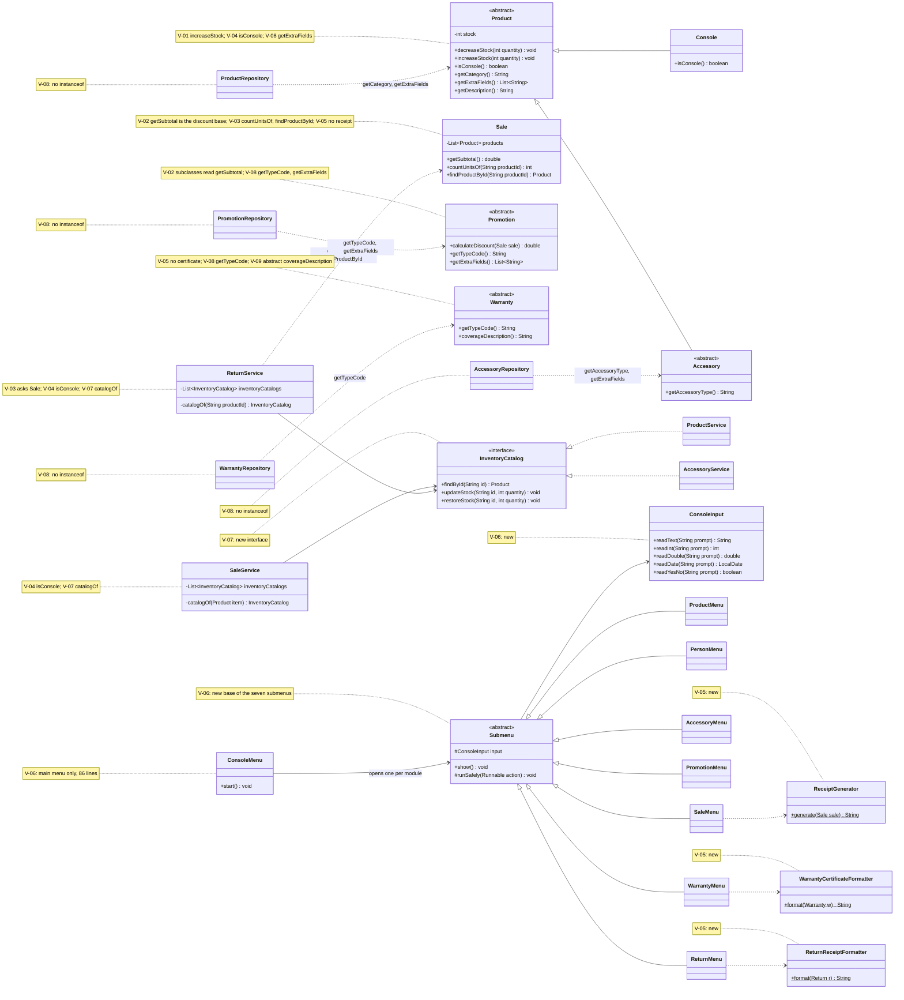

# GRASP Class Diagram — Before and After

Classes involved in the nine violations of `docs/grasp-audit/consolidated-audit.md`. Only the
members related to each violation are shown. Notes give the violation identifiers of each
class.

## Before (start of Phase 2, `develop` at `ae12127`)

## After (end of Phase 2, `develop` at `63604f3`)

New classes: `InventoryCatalog`, `ReceiptGenerator`, `ReturnReceiptFormatter`,
`WarrantyCertificateFormatter`, `ConsoleInput`, `Submenu` and the seven submenus. Removed
members: `Sale.generateReceipt`, `Return.generateReturnReceipt`,
`Warranty.generateWarrantyCertificate`, the `instanceof` chains of the repositories and of the
services, and the private helpers that walked the products of a sale from outside.

`Product.getDescription` and `Accessory.getDescription` stay in the model on purpose: moving
them would force an `instanceof` per subclass in the interface, which is a new violation of
Polymorphism. The decision is justified in `docs/grasp-refactor-log.md`.
