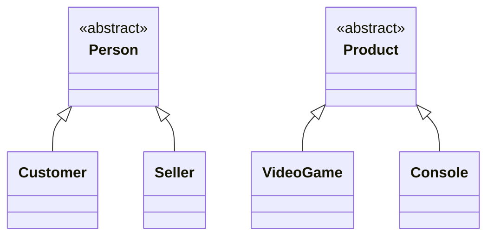

# Hierarchy Diagram — GameZone Unicesar

Inheritance relationships of the model layer. Following the workshop rules, it shows no
associations, attributes or methods.

| Hierarchy | Base class (abstract) | Derived classes (concrete) |
|---|---|---|
| People | `Person` | `Customer`, `Seller` |
| Products | `Product` | `VideoGame`, `Console` |

- `Person` and `Product` are **abstract**: they represent general categories that are
  never instantiated directly.
- `Customer`, `Seller`, `VideoGame` and `Console` are **concrete**: they are the objects
  the system actually creates.
