# Integrated Class Diagram — GameZone Unicesar

One class diagram with the four layers and every module of the integrated system: people,
products, accessories, sales, promotions, warranties and returns.

- Visibility: `+` public, `-` private, `#` protected.
- `<<abstract>>` marks abstract classes; `*` after a method marks an abstract method; `$`
  marks a static method.
- Getters and setters are omitted to keep the diagram readable. Every attribute is
  `private` and is reached through its getter, and through its setter when it has one.
- The per-module diagrams (`docs/class-diagram.md`, `docs/accessory-class-diagram.md`,
  `docs/promotion-class-diagram.md`, `docs/warranty-class-diagram.md` and
  `docs/return-class-diagram.md`) show each part in more detail.

```mermaid
classDiagram
    direction LR

    namespace ui {
        class ConsoleMenu {
            -ProductService productService
            -PersonService personService
            -SaleService saleService
            -AccessoryService accessoryService
            -PromotionService promotionService
            -WarrantyService warrantyService
            -ReturnService returnService
            -Scanner scanner
            +start() void
        }
    }

    namespace service {
        class PersonService {
            -PersonRepository repository
            -List~Customer~ customers
            -List~Seller~ sellers
            +registerCustomer(String id, String name, String phone, String email) Customer
            +listCustomers() List~Customer~
            +listSellers() List~Seller~
            +findCustomerById(String id) Customer
            +findSellerById(String idOrEmployeeCode) Seller
        }
        class ProductService {
            -ProductRepository repository
            -List~Product~ products
            +registerVideoGame(...) VideoGame
            +registerConsole(...) Console
            +listAllProducts() List~Product~
            +findById(String id) Product
            +updateStock(String productId, int quantity) void
            +restoreStock(String productId, int quantity) void
        }
        class AccessoryService {
            -AccessoryRepository repository
            -ProductService productService
            -List~Accessory~ accessories
            +registerController(...) Controller
            +registerCable(...) Cable
            +registerMemory(...) Memory
            +listAllAccessories() List~Accessory~
            +listAccessoriesByType(String type) List~Accessory~
            +findAccessoriesCompatibleWith(String consoleId) List~Accessory~
            +findById(String id) Accessory
            +updateStock(String accessoryId, int quantity) void
            +restoreStock(String accessoryId, int quantity) void
        }
        class PromotionService {
            -PromotionRepository repository
            -List~Promotion~ promotions
            +registerPercentageDiscount(...) PercentageDiscount
            +registerCategoryDiscount(...) CategoryDiscount
            +registerBulkPurchaseDiscount(...) BulkPurchaseDiscount
            +listAllPromotions() List~Promotion~
            +listActivePromotions() List~Promotion~
            +findById(String id) Promotion
            +findBestPromotionFor(Sale sale) Promotion
        }
        class WarrantyService {
            -WarrantyRepository repository
            -List~Warranty~ warranties
            +loadWarranties(List~Sale~ sales) void
            +assignBasicWarranty(Product product, Sale sale, LocalDate startDate) BasicWarranty
            +assignExtendedWarranty(Product product, Sale sale, LocalDate startDate) ExtendedWarranty
            +findWarrantyByProduct(String productId, String saleId) Warranty
            +cancelWarranties(String productId, String saleId) double
            +listAllWarranties() List~Warranty~
            +listActiveWarranties() List~Warranty~
            +listWarrantiesExpiringSoon(int daysAhead) List~Warranty~
        }
        class SaleService {
            -SaleRepository repository
            -ProductService productService
            -PersonService personService
            -AccessoryService accessoryService
            -PromotionService promotionService
            -WarrantyService warrantyService
            -List~Sale~ sales
            +registerSale(String customerId, String sellerId, List~String~ productIds, List~String~ productIdsWithExtendedWarranty) Sale
            +listAllSales() List~Sale~
            +findById(String saleId) Sale
            +findSalesByCustomer(String customerId) List~Sale~
            +findSalesBySeller(String sellerId) List~Sale~
            +getCatalog() List~Product~
        }
        class ReturnService {
            -ReturnRepository repository
            -SaleService saleService
            -ProductService productService
            -AccessoryService accessoryService
            -WarrantyService warrantyService
            -List~Return~ returns
            +registerReturn(String saleId, List~String~ productIds, String reason) Return
            +viewAllReturns() List~Return~
            +viewReturnsByCustomer(String customerId) List~Return~
            +viewReturnsBySale(String saleId) List~Return~
            +calculateMonthlySales(int month, int year) double
            +calculateMonthlyReturns(int month, int year) double
            +generateMonthlyBalance(int month, int year) double
        }
    }

    namespace persistence {
        class PersonRepository {
            -Path customersFile
            -Path sellersFile
            +saveCustomers(List~Customer~ customers) void
            +loadCustomers() List~Customer~
            +saveSellers(List~Seller~ sellers) void
            +loadSellers() List~Seller~
        }
        class ProductRepository {
            -Path filePath
            +saveAll(List~Product~ products) void
            +loadAll() List~Product~
        }
        class AccessoryRepository {
            -Path filePath
            +saveAll(List~Accessory~ accessories) void
            +loadAll() List~Accessory~
        }
        class PromotionRepository {
            -Path filePath
            +saveAll(List~Promotion~ promotions) void
            +loadAll() List~Promotion~
        }
        class WarrantyRepository {
            -Path filePath
            +saveAll(List~Warranty~ warranties) void
            +loadAll() List~WarrantyRecord~
        }
        class WarrantyRecord {
            -String type
            -String id
            -String productId
            -String saleId
            -LocalDate startDate
        }
        class SaleRepository {
            -Path filePath
            +saveAll(List~Sale~ sales) void
            +loadAll(List~Product~ products, List~Customer~ customers, List~Seller~ sellers) List~Sale~
        }
        class ReturnRepository {
            -Path filePath
            +saveAll(List~Return~ returns) void
            +loadAll(List~Sale~ sales) List~Return~
        }
    }

    namespace model {
        class Person {
            <<abstract>>
            -String id
            -String name
            -String phone
            +getRole() String*
            +getSummary() String*
        }
        class Customer {
            -String email
        }
        class Seller {
            -String employeeCode
            -String shift
        }
        class Product {
            <<abstract>>
            -String id
            -String title
            -double price
            -int stock
            +getDescription() String*
            +getCategory() String*
            +hasStock(int quantity) boolean
            +decreaseStock(int quantity) void
        }
        class VideoGame {
            -String platform
            -String genre
            -String ageRating
        }
        class Console {
            -String brand
            -String model
            -String generation
        }
        class Accessory {
            <<abstract>>
            -List~String~ compatibleConsoleIds
            +getAccessoryType() String*
            +isCompatibleWith(String consoleId) boolean
            +addCompatibleConsole(String consoleId) void
            +removeCompatibleConsole(String consoleId) void
        }
        class Controller {
            -String connectionType
        }
        class Cable {
            -double lengthInMeters
            -String connectorType
        }
        class Memory {
            -int capacityInGb
            -String memoryType
        }
        class Sale {
            -String id
            -LocalDate date
            -Customer customer
            -Seller seller
            -List~Product~ products
            -double subtotal
            -String appliedPromotionName
            -double discountAmount
            -double extendedWarrantyCost
            -double total
            +calculateSubtotal() double
            +calculateTotal() double
            +applyDiscount(String promotionName, double amount) void
            +addExtendedWarrantyCost(double cost) void
            +canBeReturned() boolean
            +generateReceipt() String
        }
        class Promotion {
            <<abstract>>
            -String id
            -String name
            -LocalDate startDate
            -LocalDate endDate
            +isActive(LocalDate date) boolean
            +calculateDiscount(Sale sale) double*
            +getDescription() String*
        }
        class PercentageDiscount {
            -double percentage
        }
        class CategoryDiscount {
            -double percentage
            -String targetCategory
        }
        class BulkPurchaseDiscount {
            -int minimumQuantity
            -double percentage
        }
        class Warranty {
            <<abstract>>
            -String id
            -Product product
            -Sale sale
            -LocalDate startDate
            -LocalDate endDate
            +getDurationInMonths() int*
            +getWarrantyType() String*
            +getAdditionalCost() double*
            +isActive(LocalDate date) boolean
            +generateWarrantyCertificate() String
        }
        class BasicWarranty
        class ExtendedWarranty
        class Return {
            -String id
            -LocalDate date
            -Sale sale
            -List~Product~ returnedProducts
            -String reason
            -double warrantyRefund
            -double refundAmount
            +calculateRefundAmount() double
            +generateReturnReceipt() String
        }
    }

    class Main {
        +main(String[] args)$ void
    }

    %% inheritance
    Person <|-- Customer
    Person <|-- Seller
    Product <|-- VideoGame
    Product <|-- Console
    Product <|-- Accessory
    Accessory <|-- Controller
    Accessory <|-- Cable
    Accessory <|-- Memory
    Promotion <|-- PercentageDiscount
    Promotion <|-- CategoryDiscount
    Promotion <|-- BulkPurchaseDiscount
    Warranty <|-- BasicWarranty
    Warranty <|-- ExtendedWarranty

    %% model relationships
    Sale "0..*" --> "1" Customer : customer
    Sale "0..*" --> "1" Seller : seller
    Sale "0..*" o-- "1..*" Product : products
    Warranty "0..*" --> "1" Product : covers
    Warranty "0..*" --> "1" Sale : comes from
    Return "0..*" --> "1" Sale : original sale
    Return "0..*" o-- "1..*" Product : returned units
    Promotion ..> Sale : calculates discount for

    %% ui -> service
    ConsoleMenu --> ProductService
    ConsoleMenu --> PersonService
    ConsoleMenu --> SaleService
    ConsoleMenu --> AccessoryService
    ConsoleMenu --> PromotionService
    ConsoleMenu --> WarrantyService
    ConsoleMenu --> ReturnService

    %% service -> service
    AccessoryService --> ProductService : checks consoles and ids
    SaleService --> PersonService : customer and seller
    SaleService --> ProductService : products and stock
    SaleService --> AccessoryService : accessories and stock
    SaleService --> PromotionService : best promotion
    SaleService --> WarrantyService : assigns warranties
    ReturnService --> SaleService : original sale
    ReturnService --> ProductService : restores stock
    ReturnService --> AccessoryService : restores stock
    ReturnService --> WarrantyService : cancels warranties

    %% service -> persistence
    PersonService --> PersonRepository
    ProductService --> ProductRepository
    AccessoryService --> AccessoryRepository
    PromotionService --> PromotionRepository
    WarrantyService --> WarrantyRepository
    SaleService --> SaleRepository
    ReturnService --> ReturnRepository
    WarrantyRepository ..> WarrantyRecord : returns

    %% entry point
    Main ..> ConsoleMenu : creates and wires every layer
```



## How the layers depend on each other

```
ui ──► service ──► persistence ──► model
          └────────────────────────► model
```

- `ConsoleMenu` only talks to the services.
- The services are the only classes that call the repositories, and some services
  delegate to others. For example, `SaleService` uses `PromotionService` and
  `WarrantyService`, and `ReturnService` uses `AccessoryService` to restore accessory
  stock.
- The repositories depend only on the model. `SaleRepository`, `ReturnRepository` and
  `WarrantyService.loadWarranties` receive objects already loaded and link them by id, so
  no object is loaded twice and there is no circular dependency.
- `Main` creates the repositories and the services in this order:
  1. products;
  2. people;
  3. accessories;
  4. promotions;
  5. warranties (empty);
  6. sales;
  7. load the warranties;
  8. returns;
  9. the menu.
