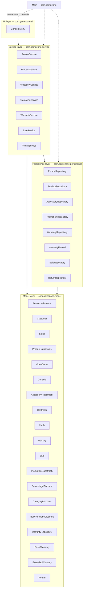

# Layers Diagram — GameZone Unicesar

The four layers of the integrated system, their classes and the allowed dependencies
between them.

## Classes per layer

| Layer | Package | Classes |
|---|---|---|
| UI | `com.gamezone.ui` | `ConsoleMenu` |
| Service | `com.gamezone.service` | `PersonService`, `ProductService`, `AccessoryService`, `PromotionService`, `WarrantyService`, `SaleService`, `ReturnService` |
| Persistence | `com.gamezone.persistence` | `PersonRepository`, `ProductRepository`, `AccessoryRepository`, `PromotionRepository`, `WarrantyRepository`, `WarrantyRecord`, `SaleRepository`, `ReturnRepository` |
| Model | `com.gamezone.model` | `Person`, `Customer`, `Seller`, `Product`, `VideoGame`, `Console`, `Accessory`, `Controller`, `Cable`, `Memory`, `Sale`, `Promotion`, `PercentageDiscount`, `CategoryDiscount`, `BulkPurchaseDiscount`, `Warranty`, `BasicWarranty`, `ExtendedWarranty`, `Return` |

`Main` lives in the root package `com.gamezone`. It only builds the objects and connects
them at startup.

## Dependency rules

| From | Allowed to use | Not allowed to use |
|---|---|---|
| UI | Service (and the model objects it returns, only to show them) | Persistence |
| Service | Persistence, Model, and other services | UI |
| Persistence | Model | Service, UI |
| Model | — | Any other layer |

- Solid arrows are dependencies allowed by the design: `ui → service → persistence → model`,
  plus `service → model`.
- Dotted arrows show what `Main` creates at startup.
- The menu never reaches the repositories; every operation goes through a service.
- Some services use other services. For example, `SaleService` uses `PromotionService` and
  `WarrantyService`, and `ReturnService` uses `AccessoryService` and `WarrantyService`. A
  service never uses another module's repository.
- Repositories that need objects from other modules (`SaleRepository`, `ReturnRepository`)
  receive them already loaded. `WarrantyRepository` returns plain `WarrantyRecord` ids and
  `WarrantyService` links them, so the persistence layer never depends on a service.
