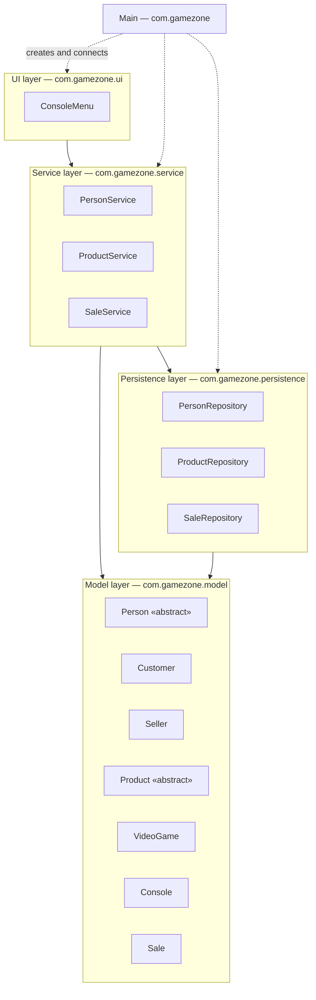

# Layers Diagram — GameZone Unicesar

The four layers of the system, their classes and the allowed dependencies between them.

## Classes per layer

| Layer | Package | Classes |
|---|---|---|
| UI | `com.gamezone.ui` | `ConsoleMenu` |
| Service | `com.gamezone.service` | `PersonService`, `ProductService`, `SaleService` |
| Persistence | `com.gamezone.persistence` | `PersonRepository`, `ProductRepository`, `SaleRepository` |
| Model | `com.gamezone.model` | `Person`, `Customer`, `Seller`, `Product`, `VideoGame`, `Console`, `Sale` |

`Main` lives in the root package `com.gamezone` and only builds the objects and connects
them at startup.

## Dependency rules

| From | Allowed to use | Not allowed to use |
|---|---|---|
| UI | Service (and the model objects it returns, only to show them) | Persistence |
| Service | Persistence, Model | UI |
| Persistence | Model | Service, UI |
| Model | — | Any other layer |

- Solid arrows are dependencies allowed by the design: `ui → service → persistence → model`,
  plus `service → model`.
- Dotted arrows show what `Main` creates at startup.
- The menu never reaches the repositories; every operation goes through a service.
