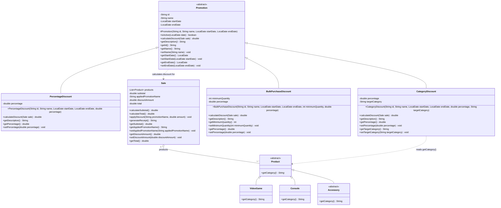
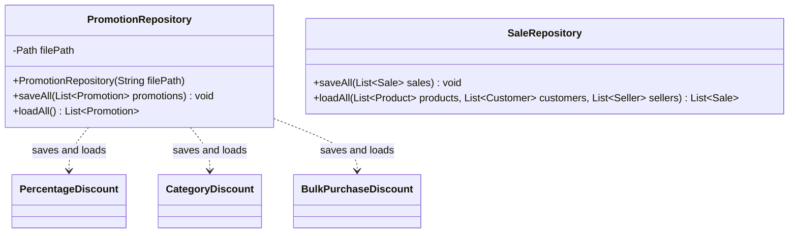
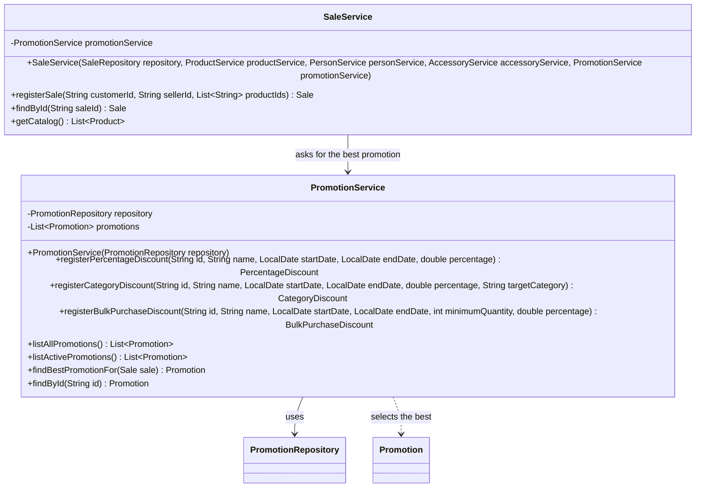
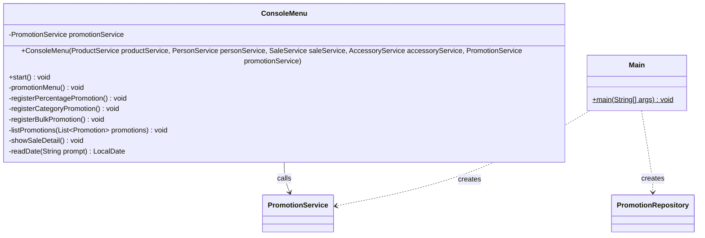

# Promotion Module Class Diagram — GameZone Unicesar

New classes of Requirement 2 and how they connect with the existing system. Classes that
already existed are shown only with the members relevant to this module.

- Visibility: `+` public, `-` private, `#` protected.
- `<<abstract>>` marks abstract classes; `*` after a method marks an abstract method.

---

## Model — `com.gamezone.model`



**`Promotion`**
- `isActive(date)` returns `true` when `startDate <= date <= endDate`.
- `calculateDiscount(sale)` returns the discount in pesos and never changes the sale. It
  computes its base from `sale.getProducts()`, the sum of the prices of every unit (the
  subtotal), so it never depends on a discount already applied.
  - `PercentageDiscount`: sum of the prices × `percentage / 100`.
  - `CategoryDiscount`: adds up the prices of the products whose `getCategory()` equals
    `targetCategory`, and applies the percentage to that sum.
  - `BulkPurchaseDiscount`: sum of the prices × `percentage / 100` if the sale has at least
    `minimumQuantity` units (`getProducts().size()`); otherwise `0`.
- `getDescription()` returns a line in Spanish with the id, the name, the dates and the
  rule, for example `[P-01] Descuento de temporada | 2026-10-01 a 2026-12-31 | 5% sobre el
  total`.

**`Product.getCategory()`** is a new abstract method:
- `VideoGame` returns `"VIDEOGAME"`.
- `Console` returns `"CONSOLE"`.
- `Accessory` returns `"ACCESSORY"`.

**`Sale`**
- `total = subtotal - discountAmount`.
- `applyDiscount` sets the promotion name and the amount and recalculates the total.
- `generateReceipt` shows the subtotal, the discount with the promotion name, and the
  total.

---

## Persistence — `com.gamezone.persistence`



**`PromotionRepository`**
- File: `data/promotions.csv`, with a header line, preloaded with one promotion of each
  type valid from `2026-10-01` to `2026-12-31`.
- Format: `type;id;name;startDate;endDate;percentage;extra`.
  - The type (`PERCENTAGE`, `CATEGORY`, `BULK`) tells which subclass to rebuild.
  - `extra` is the target category for `CATEGORY`, the minimum quantity for `BULK`, and
    empty for `PERCENTAGE`.
  - Dates use the format `yyyy-MM-dd`.
- `loadAll` returns an empty list when the file does not exist and skips damaged lines.
  Like the other repositories, both methods declare `throws IOException`.

Example of `data/promotions.csv`:

```
type;id;name;startDate;endDate;percentage;extra
PERCENTAGE;P-01;Descuento de temporada;2026-10-01;2026-12-31;5;
CATEGORY;P-02;Videojuegos al 20%;2026-10-01;2026-12-31;20;VIDEOGAME
BULK;P-03;Lleva 3 o más;2026-10-01;2026-12-31;10;3
```

**`SaleRepository`** adds two columns at the end of each sale line: the promotion name
(empty if none) and the discount amount. Lines saved before this requirement, without
those columns, still load as sales without a discount.

---

## Services — `com.gamezone.service`



**`PromotionService`**
- Loads the promotions in its constructor and saves after every change. File errors
  become `IllegalStateException`, like in the other services.
- `listActivePromotions()` uses today's date. `findBestPromotionFor(sale)` uses the date of
  the sale.
- `findBestPromotionFor` returns `null` when no active promotion gives a discount greater
  than zero.
- `findById` ignores letter case.
- It rejects invalid data with an `IllegalArgumentException` and a message in Spanish:
  - empty id or name, or an id already registered;
  - missing dates, or an end date before the start date;
  - a percentage that is not greater than 0 and at most 100;
  - a target category other than `VIDEOGAME` or `CONSOLE`;
  - a minimum quantity that is not greater than zero.

**`SaleService`**
- New dependency: `PromotionService`.
- `registerSale`, after creating the sale, calls `findBestPromotionFor(sale)`. If it gets a
  promotion, it calls `applyDiscount(promotion.getName(), promotion.calculateDiscount(sale))`
  on the sale. Its signature does not change.
- New `findById(saleId)` to show the detail of one sale; it returns `null` if the sale
  does not exist.

---

## User interface and entry point



- New main menu option **5. Gestión de promociones**:
  1. Registrar promoción por porcentaje
  2. Registrar promoción por categoría
  3. Registrar promoción por volumen
  4. Listar todas las promociones
  5. Listar promociones vigentes
- New sales submenu option **5. Ver detalle de una venta**, which shows the receipt with
  the subtotal, the discount and the total.
- Dates are typed as `AAAA-MM-DD`.
- `Main` creates `PromotionRepository` with `data/promotions.csv` and `PromotionService`,
  and passes it to `SaleService` and `ConsoleMenu`.

## Who implements what

| Member | Work |
|---|---|
| Developer 1 (Andrés) | `Promotion`, `PercentageDiscount`, `CategoryDiscount`, `BulkPurchaseDiscount`; `getCategory()` in `Product`, `VideoGame`, `Console` and `Accessory` |
| Developer 2 (José) | `PromotionRepository`, `PromotionService`, `data/promotions.csv` |
| Technical Leader (Rafael) | Changes in `Sale`, `SaleRepository`, `SaleService`, `ConsoleMenu`, `Main` and `README.md` |
