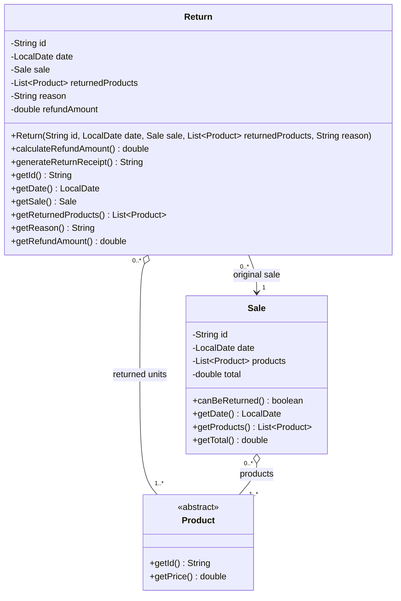
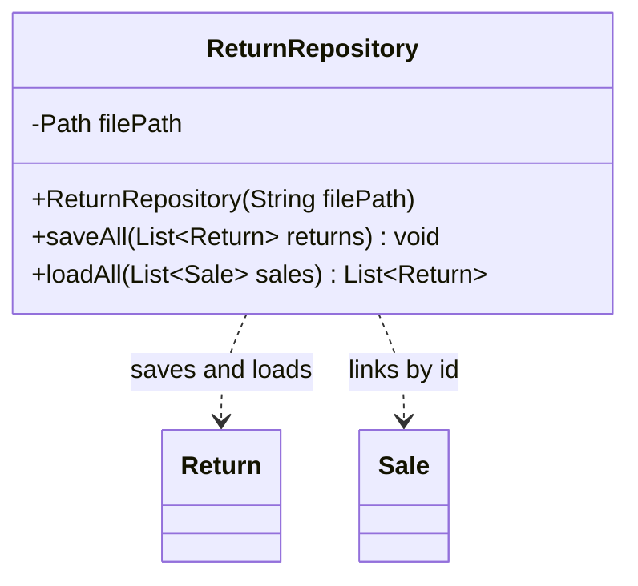
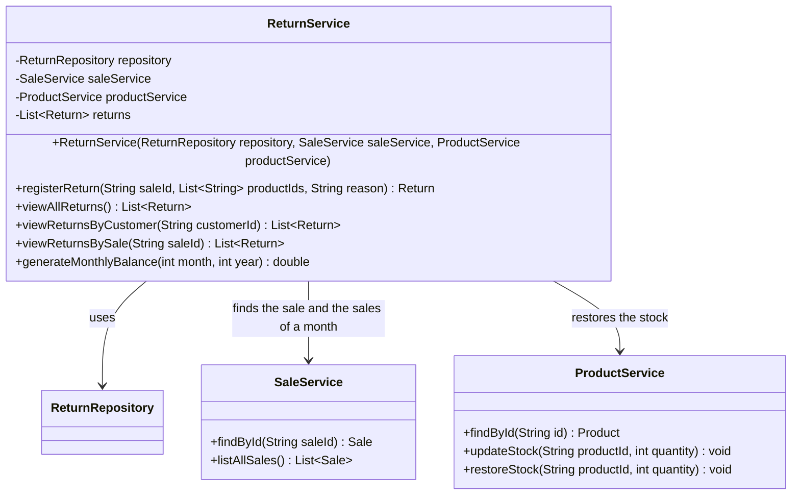
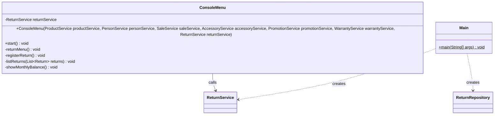

# Return Module Class Diagram — GameZone Unicesar

New classes of Requirement 3 and how they connect with the existing system. Classes that
already existed are shown only with the members relevant to this module.

- Visibility: `+` public, `-` private, `#` protected.

---

## Model — `com.gamezone.model`



**`Return`**
- The constructor stores a copy of the returned list and calls `calculateRefundAmount()`.
- There are only getters: the sale, the products and the reason never change after the
  return is registered.
- `calculateRefundAmount()` adds up the prices of the returned products, stores the result
  in `refundAmount` and returns it.
- `generateReturnReceipt()` returns a text in Spanish with:
  - the return id and date;
  - the original sale (id, date and customer);
  - each returned product with its price;
  - the reason;
  - the refunded amount.

**`Sale.canBeReturned()`**
- New method: `true` when `ChronoUnit.DAYS.between(date, LocalDate.now())` is between `0`
  and `30`.

---

## Persistence — `com.gamezone.persistence`



- File: `data/returns.csv`, with a header line. No preloaded data is needed.
- Format: `id;date;saleId;productIds;reason`, with the product ids separated by commas:
  ```
  id;date;saleId;productIds;reason
  R0001;2026-10-18;S0001;C-01,A-01;No funciona
  ```
- The refund is not stored, because the constructor of `Return` computes it again.
- `loadAll(sales)` links each return to its sale by id. Each returned id is linked to the
  product with that id inside `sale.getProducts()`, so it works for video games, consoles
  and accessories.
- It skips damaged lines and lines whose sale or product cannot be found, and returns an
  empty list when the file does not exist.
- A `;` inside the reason is saved as `,`.
- Like the other repositories, both methods declare `throws IOException`.

---

## Services — `com.gamezone.service`



**`ReturnService`**
- The constructor loads the returns with `repository.loadAll(saleService.listAllSales())`.
  File errors become `IllegalStateException`.
- `registerReturn(saleId, productIds, reason)` does the following, in order, and changes
  nothing until every check passes:
  1. The sale must exist (`saleService.findById`, ignoring letter case).
  2. The sale must be within 30 days (`sale.canBeReturned()`).
  3. The list must have at least one product, and the reason cannot be empty.
  4. Every id must belong to the sale. The units of each id cannot be more than the units
     sold minus the units already returned in earlier returns of that sale.
  5. It creates the `Return` with the next id (`R0001`, `R0002`...) and today's date.
  6. For the returned **products** (video games and consoles) it calls
     `productService.restoreStock(id, units)`.
  7. It saves the returns and returns the new `Return`.
- If a check fails, it throws an `IllegalArgumentException` with a message in Spanish.
- `viewReturnsByCustomer(customerId)` filters by the customer of the sale.
  `viewReturnsBySale(saleId)` filters by sale, ignoring letter case.
- `generateMonthlyBalance(month, year)` adds up `getTotal()` of the sales whose date is in
  that month and year, subtracts the `getRefundAmount()` of the returns whose date is in
  that month and year, and returns the result.

**`ProductService.restoreStock(productId, quantity)`** (new)
- It adds `quantity` units to the product and saves the inventory.
- It rejects a product that does not exist or a quantity that is not greater than zero.

---

## User interface and entry point



- New main menu option **7. Gestión de devoluciones**:
  1. Registrar devolución: sale id, the receipt of the sale, products to return with
     their quantities, and the reason.
  2. Consultar todas las devoluciones
  3. Consultar devoluciones por cliente
  4. Consultar devoluciones por venta
  5. Consultar balance mensual (asks for the month and the year)
- `Main` creates `ReturnRepository` with `data/returns.csv` and `ReturnService` after
  `SaleService` and the warranties, and passes it to `ConsoleMenu`.

## Who implements what

| Member | Work |
|---|---|
| Developer 1 (Andrés) | `Return`; `Sale.canBeReturned()` |
| Developer 2 (José) | `ReturnRepository`, `ReturnService` (including the monthly balance) |
| Technical Leader (Rafael) | `ProductService.restoreStock`, `ConsoleMenu`, `Main` and `README.md` |
