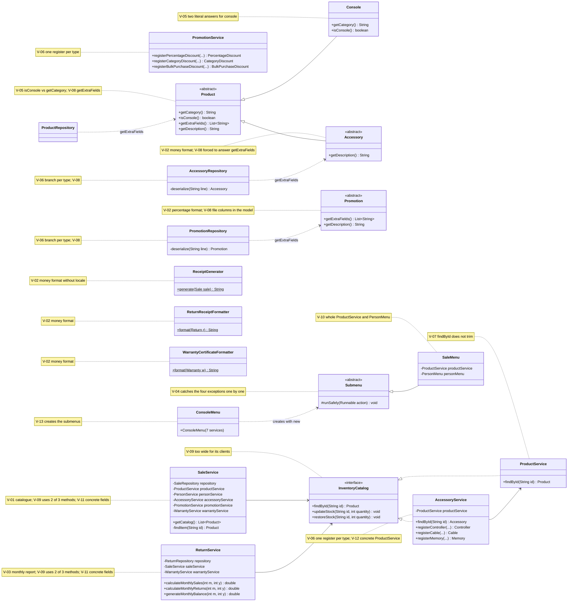
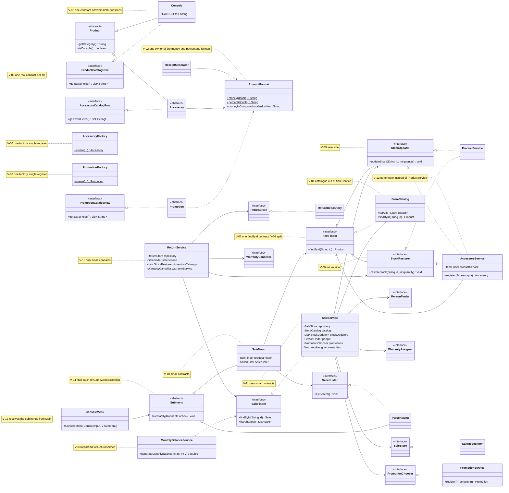

# SOLID Class Diagram — Before and After

Classes involved in the thirteen violations of `docs/solid-audit/consolidated-audit.md`. Only
the members related to each violation are shown. Notes give the violation identifiers of each
class.

## Before (start of Phase 2, `develop` at `94cfe02`)

## After (end of Phase 2)

New: `StoreCatalog`, `MonthlyBalanceService`, `AmountFormat`, `AccessoryFactory`,
`PromotionFactory`, the three catalogue row contracts and the small contracts `ItemFinder`,
`StockUpdater`, `StockRestorer`, `SaleFinder`, `SaleStore`, `ReturnStore`, `PersonFinder`,
`PromotionChooser`, `WarrantyAssigner`, `WarrantyCanceller` and `SellerLister`. Removed:
`InventoryCatalog`, the per-type `register...` methods of the accessory and promotion services,
`SaleService.getCatalog` and `findItem`, and the monthly balance of `ReturnService`.

