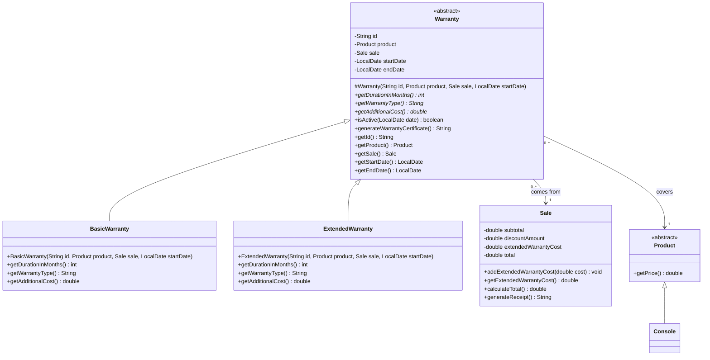
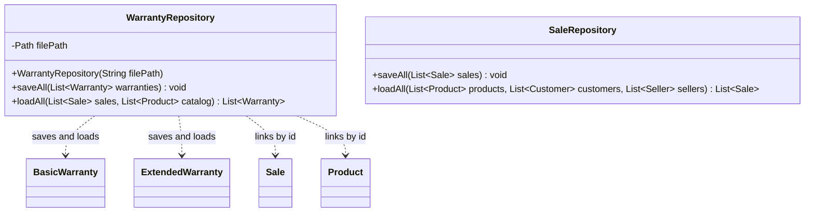
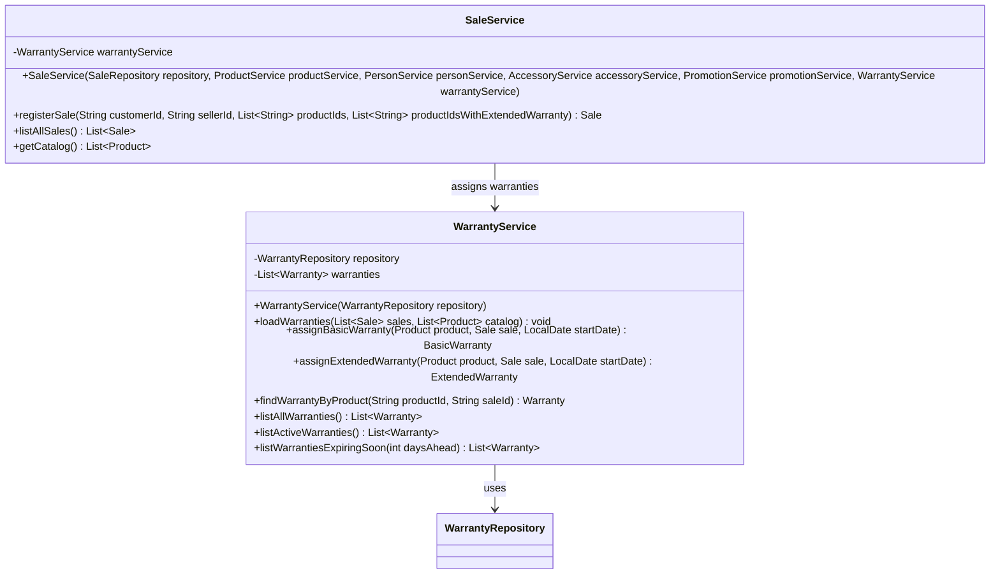
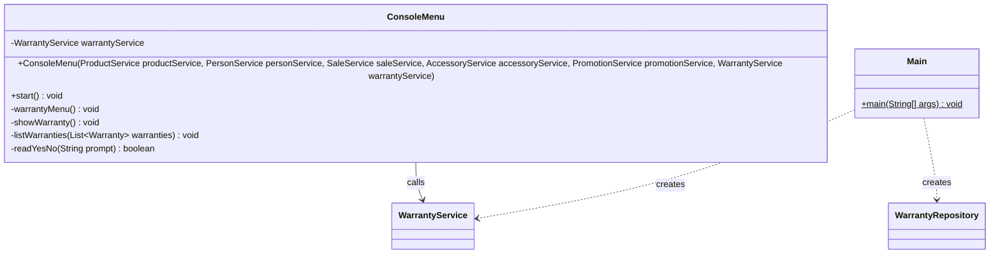

# Warranty Module Class Diagram — GameZone Unicesar

New classes of Requirement 4 and how they connect with the existing system. Classes that
already existed are shown only with the members relevant to this module.

- Visibility: `+` public, `-` private, `#` protected.
- `<<abstract>>` marks abstract classes; `*` after a method marks an abstract method.

---

## Model — `com.gamezone.model`



**`Warranty`**
- The constructor computes `endDate = startDate.plusMonths(getDurationInMonths())`. There
  are no setters, so the dates and links never change after creation.
- `isActive(date)` returns `true` when `startDate <= date <= endDate`.
- `generateWarrantyCertificate()` returns a text in Spanish with:
  - the warranty id and type;
  - the product id and title;
  - the sale id and customer name;
  - the start and end dates;
  - the coverage: "defectos de fábrica" for the basic warranty, "defectos de fábrica y
    daños accidentales" for the extended one;
  - whether it is active today.

**Subclasses**
- `BasicWarranty`: `6` months, `"Garantía Básica"`, cost `0.0`.
- `ExtendedWarranty`: `12` months, `"Garantía Extendida"`, cost
  `getProduct().getPrice() * 0.10`.

**`Sale`**
- New attribute `extendedWarrantyCost`, `0` by default.
- `addExtendedWarrantyCost(cost)` adds to it and recalculates the total:
  `total = subtotal - discountAmount + extendedWarrantyCost`.
- The receipt adds the line `Garantías extendidas: $...`.

---

## Persistence — `com.gamezone.persistence`



**`WarrantyRepository`**
- File: `data/warranties.csv`, with a header line. No preloaded data is needed.
- Format: `type;id;productId;saleId;startDate`. For example:
  ```
  type;id;productId;saleId;startDate
  BASIC;W0001;C-01;S0003;2026-10-18
  EXTENDED;W0002;C-01;S0003;2026-10-18
  ```
- The type (`BASIC` or `EXTENDED`) tells which subclass to rebuild. The end date is not
  stored, because the constructor computes it again.
- `loadAll(sales, catalog)` receives the objects already loaded and links each warranty to
  them by id. It skips lines whose sale or product no longer exist, skips damaged lines,
  and returns an empty list when the file does not exist.
- Like the other repositories, both methods declare `throws IOException`.

**`SaleRepository`** adds one column at the end of each sale line: the extended warranty
cost. Older lines without it load with a cost of `0`.

---

## Services — `com.gamezone.service`



**`WarrantyService`**
- The constructor starts with an empty list. `loadWarranties(sales, catalog)` loads the
  file once the sales exist; `Main` calls it right after creating `SaleService`.
- `assignBasicWarranty` and `assignExtendedWarranty` create the warranty with the next id
  (`W0001`, `W0002`...), save the file and return it.
- `findWarrantyByProduct(productId, saleId)` ignores letter case. If the product has both
  warranties in that sale, it returns the one that ends last (the extended one). It
  returns `null` if there is none.
- `listActiveWarranties()` uses today's date.
- `listWarrantiesExpiringSoon(daysAhead)` returns the active warranties whose end date is
  within the next `daysAhead` days. It rejects a value that is not greater than zero with
  an `IllegalArgumentException` and a message in Spanish.
- File errors become `IllegalStateException`, like in the other services.

**`SaleService.registerSale`**
- New parameter: `productIdsWithExtendedWarranty`.
- Ids in that list that are not consoles in the sale are rejected.
- After creating the sale and applying the promotion, each unit that is a `Console` gets
  a basic warranty.
- If its id was requested, it also gets an extended warranty, and its cost is added with
  `sale.addExtendedWarrantyCost(...)`.

---

## User interface and entry point



- **Registering a sale:** after choosing the items, the menu asks once per console in the
  sale: `¿Desea agregar garantía extendida a PlayStation 5 Slim? (s/n)`.
- New main menu option **6. Gestión de garantías**:
  1. Consultar la garantía de un producto en una venta
  2. Listar todas las garantías
  3. Listar garantías vigentes
  4. Listar garantías próximas a vencer (asks how many days)
- `Main` creates `WarrantyRepository` with `data/warranties.csv` and `WarrantyService`,
  passes it to `SaleService` and `ConsoleMenu`, and calls
  `warrantyService.loadWarranties(saleService.listAllSales(), saleService.getCatalog())`
  after creating `SaleService`.

## Who implements what

| Member | Work |
|---|---|
| Developer 1 (Andrés) | `Warranty`, `BasicWarranty`, `ExtendedWarranty` |
| Developer 2 (José) | `WarrantyRepository`, `WarrantyService` |
| Technical Leader (Rafael) | Changes in `Sale`, `SaleRepository`, `SaleService`, `ConsoleMenu`, `Main` and `README.md` |
